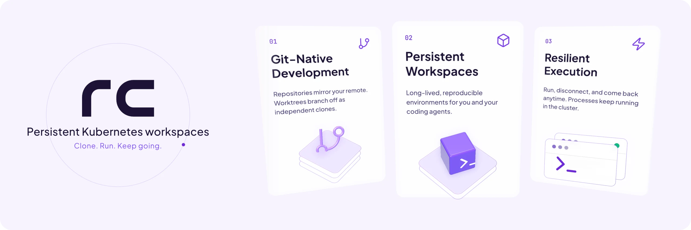
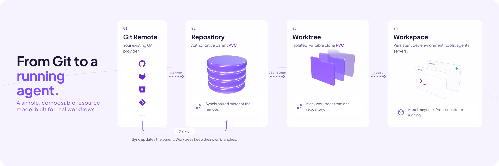
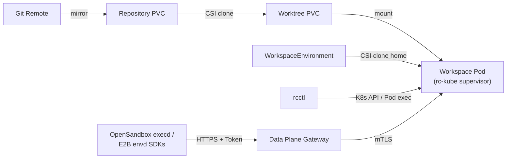
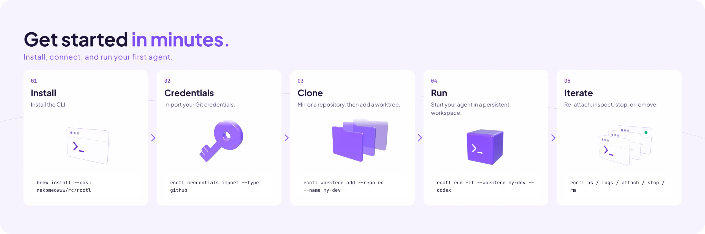
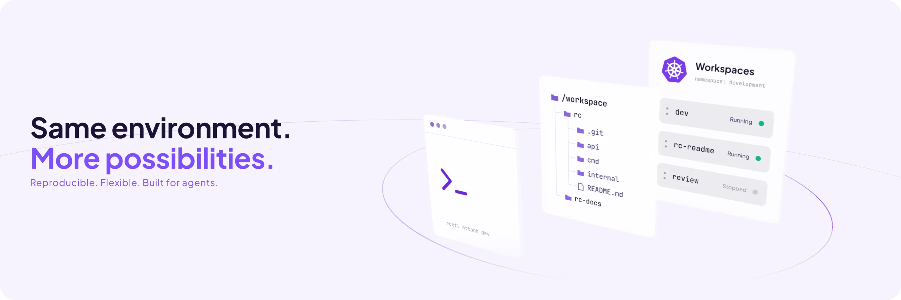

<picture>
  <source
    width="100%"
    srcset="./docs/images/cover-dark.webp"
    media="(prefers-color-scheme: dark)"
  />
  <source
    width="100%"
    srcset="./docs/images/cover-light.webp"
    media="(prefers-color-scheme: light), (prefers-color-scheme: no-preference)"
  />
  
</picture>

<h1 align="center">rc</h1>

`rc` runs persistent, Kubernetes-native development workspaces and agent sandboxes.

- **Git-native storage**: **Repositories** mirror Git remotes on PVCs; **Worktrees** branch off as independent CSI volume clones without re-cloning remotes.
- **Persistent Workspaces**: Long-lived Pods with persistent home directories, credentials, hot-mounted Worktrees, and `rc-kube` process supervision that survives terminal disconnects.
- **Sandbox SDK compatible (`e2b`, `opensandbox`)**: Opt-in per-Workspace HTTP/ConnectRPC/WebSocket data plane (`execd` & `envd`) behind an mTLS **Data Plane Gateway** — build custom agent sandboxes without Kubernetes Pod exec.
- **Multi-OS & agent-ready**: Runs on Linux (including headless Wayland GUI + [AUV](https://github.com/moeru-ai/auv) Computer Use), Windows, and macOS, with first-class `rcctl` workflows and installable Agent Skills.

> [!NOTE]
> `rc` is under active development. Its CRDs are currently `v1alpha1` and may change between releases.

## Table of Contents

- [Start here](#start-here)
- [How it works](#how-it-works)
- [Getting started with `rcctl`](#getting-started-with-rcctl)
- [Deploy](#deploy)
- [Use with sandbox SDKs (`e2b`, `opensandbox`, etc.)](#use-with-sandbox-sdks-e2b-opensandbox-etc)
- [Agent Skills](#agent-skills)
- [Platform support](#platform-support)
- [Resource model at a glance](#resource-model-at-a-glance)
- [Documentation](#documentation)
- [Contributing](#contributing)
- [License](#license)

## Start here

| If you are... | Start with |
| --- | --- |
| **A developer using `rcctl`** | [Getting started with `rcctl`](#getting-started-with-rcctl) · [Agent Skills](#agent-skills) · [Using `rcctl`](docs/guides/rcctl.md) |
| **A platform engineer or SDK user** building agent sandboxes with `e2b` / `opensandbox` | [Use with sandbox SDKs](#use-with-sandbox-sdks-e2b-opensandbox-etc) · [Data Plane guide](docs/guides/data-plane.md) |
| **A cluster operator or Kubernetes developer** | [Deploy](#deploy) · [Operations & custom images](docs/guides/operations.md) · [Doctor](docs/doctor.md) |

## How it works

<picture>
  <source
    width="100%"
    srcset="./docs/images/resource-model-dark.webp"
    media="(prefers-color-scheme: dark)"
  />
  <source
    width="100%"
    srcset="./docs/images/resource-model-light.webp"
    media="(prefers-color-scheme: light), (prefers-color-scheme: no-preference)"
  />
  
</picture>



`rc` consists of three binaries:

- **`rc-controller`** reconciles `Repository`, `Worktree`, `WorkspaceEnvironment`, `Workspace`, `WorkspaceExec`, and `Credential` CRDs, and also serves the **Data Plane Gateway** (`manager data-plane-gateway`).
- **`rc-kube`** supervises processes, transcripts, resident services, and opt-in `execd` / `envd` endpoints inside every Workspace Pod (injected automatically on Linux).
- **`rcctl`** provides the day-to-day CLI for repositories, worktrees, workspaces, credentials, file copy, and process attachment.

## Getting started with `rcctl`

<picture>
  <source
    width="100%"
    srcset="./docs/images/quick-start-dark.webp"
    media="(prefers-color-scheme: dark)"
  />
  <source
    width="100%"
    srcset="./docs/images/quick-start-light.webp"
    media="(prefers-color-scheme: light), (prefers-color-scheme: no-preference)"
  />
  
</picture>

Install `rcctl` via Homebrew (or see [Installation](docs/guides/installation.md#install-rcctl) for GitHub Releases and `go install`):

```sh
brew install --cask nekomeowww/rc/rcctl
```

Clone a repository mirror, branch an independent Worktree, and launch an interactive Workspace:

```sh
# 1. Mirror a repository (replace csi-hostpath-sc with your clone-capable StorageClass)
rcctl -n development repo clone https://github.com/nekomeowww/rc.git \
  --name rc --storage-class csi-hostpath-sc

# 2. Branch an independent Worktree via CSI PVC clone
rcctl -n development worktree add --repo rc --name rc-dev --branch feat/demo

# 3. Create a persistent Workspace and mount the Worktree
rcctl -n development workspace create dev \
  --image ghcr.io/nekomeowww/rc/runner:latest \
  --storage-class csi-hostpath-sc
rcctl -n development workspace mount worktree rc-dev --workspace dev --path rc

# 4. Run an interactive command (survives terminal disconnects)
rcctl -n development exec -it --cwd /workspace/rc dev -- sh
```

Day-2 commands:

```sh
rcctl -n development ps                  # List running processes across Workspaces
rcctl -n development logs <process-id>   # Stream or inspect process logs
rcctl -n development attach <process-id> # Reconnect to a running terminal
rcctl -n development cp ./file dev:/workspace/rc/file
rcctl -n development doctor              # Read-only health and storage audit
```

See [Using `rcctl`](docs/guides/rcctl.md) for credentials, `repo sync`, temporary `rcctl run`, Linux Worktree hot-mounts, lifetimes, and npm caching.

## Deploy

`rc` requires a Kubernetes `StorageClass` that supports **CSI volume cloning** and **`Immediate` volume binding** (not `WaitForFirstConsumer`).

### Operator

Install the latest released controller, CRDs, and RBAC into the current Kubernetes context:

```sh
kubectl apply -f https://github.com/nekomeowww/rc/releases/latest/download/install.yaml
kubectl rollout status deployment/rc-controller-manager -n rc-system
```

Each stable release publishes matching images under `ghcr.io/nekomeowww/rc/`:

- `controller` — Kubernetes controller manager and `data-plane-gateway`
- `rc-kube` — injected Linux process supervisor and `tini`
- `runner` — default Linux Workspace runner
- `runner-wayland` — headless Wayland GUI + AUV Computer Use runner
- `runner-windows` — experimental Windows runner

### Data Plane Gateway (optional)

To expose `execd` and `envd` to external orchestrators or SDKs without Pod exec, run the Gateway subcommand from the `controller` image behind an Ingress, Gateway API route, or Cloudflare Tunnel:

```sh
/manager data-plane-gateway \
  --listen :8080 \
  --ca-secret-namespace rc-system \
  --ca-secret-name rc-data-plane-ca
```

<details>
<summary>Try locally with Kind (disposable cluster + CSI hostpath)</summary>

```sh
git clone https://github.com/nekomeowww/rc.git
cd rc
make setup-kind KIND_CLUSTER=rc-dev
kubectl config use-context kind-rc-dev
kubectl create namespace development --dry-run=client -o yaml | kubectl apply -f -
```

`make setup-kind` installs a pinned `csi-driver-host-path` release and creates the clone-capable `csi-hostpath-sc` StorageClass. Do not use it for production data.

</details>

See [Installation](docs/guides/installation.md) for development builds, registry mirrors, and uninstall instructions, and [Operations & custom images](docs/guides/operations.md) for image upgrades and custom Linux images.

## Use with sandbox SDKs (`e2b`, `opensandbox`, etc.)

Enable `spec.dataPlane.enabled: true` on a Workspace to expose both OpenSandbox `execd` and E2B `envd` wire protocols over mTLS through the Data Plane Gateway. Both protocols share the same Workspace filesystem and `rc-kube` supervisor.

### OpenSandbox SDK (`execd`)

```ts
import { ConnectionConfig, createDefaultAdapterFactory } from '@alibaba-group/opensandbox'

const execdBaseUrl = 'https://dataplane.example.com/namespaces/development/workspaces/dev/execd'
const execd = createDefaultAdapterFactory().createExecdStack({
  connectionConfig: new ConnectionConfig({ domain: new URL(execdBaseUrl).host }),
  execdBaseUrl,
  endpointHeaders: { 'X-EXECD-ACCESS-TOKEN': process.env.WORKSPACE_ACCESS_TOKEN! },
})

await execd.files.writeFiles([
  { path: '/workspace/hello.txt', data: 'hello from opensandbox', mode: 644 },
])
```

### E2B SDK (`envd`)

```ts
import { Sandbox } from 'e2b'

const sandbox = new Sandbox({
  sandboxId: 'dev',
  envdVersion: '0.11.0',
  envdAccessToken: process.env.WORKSPACE_ACCESS_TOKEN!,
  sandboxUrl: 'https://dataplane.example.com/namespaces/development/workspaces/dev/envd',
  debug: true,
})

await sandbox.files.write([
  { path: '/workspace/hello.txt', data: 'hello from e2b' },
])
const res = await sandbox.commands.run('cat /workspace/hello.txt')
```

See [Workspace Data Plane (`execd` & `envd`)](docs/guides/data-plane.md) for authentication, mTLS certificates, signed file URLs, and scope details.

## Agent Skills

Install `rc`'s agent skills with the [Skills CLI](https://www.skills.sh/docs) and select the skills that fit your workflow:

```sh
pnpm dlx skills add nekomeowww/rc
```

With `npx`:

```sh
npx skills add nekomeowww/rc
```

Keep account mappings, private endpoints, and credential caches on the access device outside shared skills — see [local access and migration](skills/use-rc/references/local-access.md).

## Platform support

Each Workspace runs a native `rc-kube` supervisor built for its operating system. The controller and Repository jobs run on Linux.

| Capability | Linux | Windows | macOS |
| --- | :---: | :---: | :---: |
| Persistent Workspace home | ✅ | ✅ | ✅ |
| Interactive terminal (attach / resize) | ✅ | ✅ | ✅ |
| Process tree cleanup | ✅ | ✅ | ✅ |
| Agent and Git credentials | ✅ | ✅ | ✅ |
| Lifecycle scripts | ✅ | ✅ | ✅ |
| GPU | ✅ | ✅ | ✅ |
| GUI applications | ✅ | ✅ | ✅ |
| Computer Use ready (powered by [AUV](https://github.com/moeru-ai/auv)) | ✅ | 🚧 | ✅ |
| Repository / Worktree mounts | ✅ | ✅ | 🚧 |
| Workspace Environments | ✅ | ✅ | 🚧 |
| ConfigMap / Secret mounts | ✅ | ✅ | 🚧 |
| Port forwarding | ✅ | ✅ | 🚧 |
| Logs while suspended | ✅ | ✅ | 🚧 |
| Worktree hot-mount without restart | ✅ | ❌ | 🚧 |

🚧 Not yet supported on this platform.

See the [Windows](docs/guides/windows-workspaces.md), [macOS](docs/guides/darwin-workspaces.md), [GUI](docs/guides/run-gui-applications.md), and [LXCFS](docs/guides/lxcfs.md) guides for setup and current limits.

## Resource model at a glance

Workspaces are ordinary Kubernetes resources, so platform teams can manage them directly with controllers, GitOps, or the Kubernetes REST API:

```yaml
apiVersion: workspaces.rc.ayaka.io/v1alpha1
kind: Workspace
metadata:
  name: dev
  namespace: development
spec:
  image: ghcr.io/nekomeowww/rc/runner:latest
  idleTimeout: 1h
  maxRunDuration: 8h
  deleteAfterSuspended: 168h
  dataPlane:
    enabled: true
  mounts:
    - name: rc
      path: rc
      worktreeRef:
        name: rc-dev
```

See [Operations & custom images](docs/guides/operations.md) for image upgrades, controller-injected `rc-kube`, custom Linux images, and Pod scheduling.

## Documentation

Browse the full index in [docs/README.md](docs/README.md):

- **Users**: [Installation](docs/guides/installation.md) · [Using `rcctl`](docs/guides/rcctl.md) · [GUI applications](docs/guides/run-gui-applications.md) · [Doctor](docs/doctor.md)
- **Platform engineers & SDKs**: [Workspace Data Plane (`execd` & `envd`)](docs/guides/data-plane.md) · [Workspace lifetimes (ADR 0007)](docs/adr/0007-workspace-lifetimes.md) · [Domain glossary](CONTEXT.md)
- **Operators**: [Operations & custom images](docs/guides/operations.md) · [LXCFS](docs/guides/lxcfs.md) · [Windows](docs/guides/windows-workspaces.md) · [macOS](docs/guides/darwin-workspaces.md) · [Experimental Windows 11 worker](docs/guides/experimental-windows-11-worker.md)
- **Architecture**: [ADRs (`docs/adr/`)](docs/adr/) · [Design specs (`docs/design/`)](docs/design/)

## Contributing

See [CONTRIBUTING.md](CONTRIBUTING.md) for the Kind development loop, test suites, generated-file rules, and pull request checklist.

## License

Licensed under the [Apache License 2.0](https://www.apache.org/licenses/LICENSE-2.0).

<picture>
  <source
    width="100%"
    srcset="./docs/images/overview-dark.webp"
    media="(prefers-color-scheme: dark)"
  />
  <source
    width="100%"
    srcset="./docs/images/overview-light.webp"
    media="(prefers-color-scheme: light), (prefers-color-scheme: no-preference)"
  />
  
</picture>
