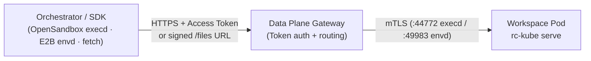

# Workspace Data Plane (`execd` & `envd`)

`rc` includes an opt-in **Workspace Data Plane** so external orchestrators, serverless/edge runtimes (such as Cloudflare Workers), and agent SDKs can read/write files, watch directories, stream command output, and run interactive PTYs over standard HTTP / WebSocket / ConnectRPC — without Kubernetes Pod exec or `rcctl`.

Two runtime wire contracts are served inside `rc-kube` behind a single **Data Plane Gateway**:

| Protocol | SDK / Ecosystem | In-Pod port (mTLS) | Gateway path prefix |
| --- | --- | :---: | --- |
| **`execd`** | `@alibaba-group/opensandbox` | `44772` | `/namespaces/<namespace>/workspaces/<name>/execd` |
| **`envd`** | `e2b` (`Sandbox` with `sandboxUrl`) | `49983` | `/namespaces/<namespace>/workspaces/<name>/envd` (also default at `/namespaces/<namespace>/workspaces/<name>/`) |

Both protocols share the same Workspace filesystem and `rc-kube` process supervisor, so files written via `execd` are immediately visible to `envd` and `rcctl`, and processes started through either protocol appear in `rcctl ps` with transcripts and activity tracking.

> [!NOTE]
> `rc` provides **data-plane wire compatibility**, not the E2B control-plane API (`/sandboxes`, templates, snapshots). Create, start, and stop `Workspace` resources through the Kubernetes API (or `rcctl`), then connect your SDK to the Data Plane Gateway URL.

## Architecture



- **No sidecars or image changes**: `rc-kube serve` implements both `execd` and `envd` directly. Because the controller injects `rc-kube` into Linux Pods, every Linux Workspace gets the Data Plane without modifying runner images.
- **mTLS between Gateway and Pods**: Runtime listeners accept only TLS connections authenticated with a Data Plane CA client certificate. Server certificates are named `<name>.<namespace>.workspace.rc.ayaka.io` and reloaded per handshake from a Workspace-owned Secret.
- **Per-Workspace access token**: The Gateway checks the caller's token (`X-EXECD-ACCESS-TOKEN` for `execd`, `X-Access-Token` or signed `/files` URL for `envd`) in constant time. The token is never placed in the Pod spec, and rotating the Secret takes effect immediately.
- **Activity & lifecycle**: Data Plane requests and running Data Plane Processes count as Workspace activity (preventing premature idle suspension), but they are not `WorkspaceExec` resources and do not block `maxRunDuration`, topology replacement, or deletion. The Gateway never starts a suspended Workspace (it returns `503` when suspended/not ready, `404` when missing or disabled, and `401` on bad/missing auth).

See [ADR 0012: Workspace Data Plane](../adr/0012-workspace-data-plane.md) and [E2B `envd` compatibility spec](../design/e2b-envd-compatibility.md) for full protocol and security details.

## 1. Enable the Data Plane on a Workspace

Set `spec.dataPlane.enabled: true` on a `Workspace`:

```yaml
apiVersion: workspaces.rc.ayaka.io/v1alpha1
kind: Workspace
metadata:
  name: sandbox-1
  namespace: development
spec:
  image: ghcr.io/nekomeowww/rc/runner:latest
  dataPlane:
    enabled: true
    # Optional: supply your own Secret key (must be >= 32 bytes).
    # When omitted, the controller generates a Workspace-owned Secret
    # and publishes its name in status.dataPlane.accessTokenSecretName.
    # accessTokenSecretRef:
    #   name: sandbox-1-token
    #   key: token
```

Read the generated token Secret name from `status.dataPlane`:

```sh
kubectl -n development get workspace sandbox-1 -o jsonpath='{.status.dataPlane.accessTokenSecretName}'
```

## 2. Run the Data Plane Gateway

The Gateway runs from the same `controller` image as a separate subcommand:

```sh
/manager data-plane-gateway \
  --listen :8080 \
  --ca-secret-namespace rc-system \
  --ca-secret-name rc-data-plane-ca
```

Key flags:

- `--listen` (default `:8080`): Serves HTTP/1.1 and h2c for fronting with an Ingress, Gateway API route, or Cloudflare Tunnel. Pass `--tls-cert-file` and `--tls-key-file` to terminate TLS directly.
- `--ca-secret-namespace` / `--ca-secret-name`: Uses the controller's internal Data Plane CA Secret to mint client certificates for mTLS to Workspace Pods. Alternatively, supply `--ca-file`, `--client-cert-file`, and `--client-key-file` when using cert-manager or an external PKI.
- `--execd-upstream-port` (default `44772`) and `--upstream-port` (default `49983`): Upstream mTLS ports on Workspace runtime Pods.

Expose the Gateway behind a single Ingress or Tunnel endpoint (for example `https://dataplane.example.com`) — no wildcard DNS or per-Workspace Ingress is required.

## 3. Connect from an SDK

### OpenSandbox SDK (`execd`)

```ts
import { ConnectionConfig, createDefaultAdapterFactory } from '@alibaba-group/opensandbox'

const execdBaseUrl = 'https://dataplane.example.com/namespaces/development/workspaces/sandbox-1/execd'
const token = process.env.WORKSPACE_ACCESS_TOKEN!

const factory = createDefaultAdapterFactory()
const execd = factory.createExecdStack({
  connectionConfig: new ConnectionConfig({ domain: new URL(execdBaseUrl).host }),
  execdBaseUrl,
  endpointHeaders: { 'X-EXECD-ACCESS-TOKEN': token },
})

await execd.files.writeFiles([
  { path: '/workspace/hello.txt', data: 'hello from opensandbox', mode: 644 },
])

const content = await execd.files.readFile('/workspace/hello.txt')
```

### E2B SDK (`envd`)

```ts
import { Sandbox } from 'e2b'

const sandbox = new Sandbox({
  sandboxId: 'sandbox-1',
  envdVersion: '0.11.0',
  envdAccessToken: process.env.WORKSPACE_ACCESS_TOKEN!,
  sandboxUrl: 'https://dataplane.example.com/namespaces/development/workspaces/sandbox-1/envd',
  debug: true,
})

await sandbox.files.write([
  { path: '/workspace/hello.txt', data: 'hello from e2b' },
])

const res = await sandbox.commands.run('cat /workspace/hello.txt')
console.log(res.stdout)
```

### Plain HTTP (`fetch` / `curl`)

```sh
# Health check (unauthenticated, returns 204 + X-Envd-Version)
curl -i https://dataplane.example.com/namespaces/development/workspaces/sandbox-1/envd/health

# Read a file
curl -H "X-Access-Token: $WORKSPACE_ACCESS_TOKEN" \
  "https://dataplane.example.com/namespaces/development/workspaces/sandbox-1/envd/files?path=/workspace/hello.txt"
```
